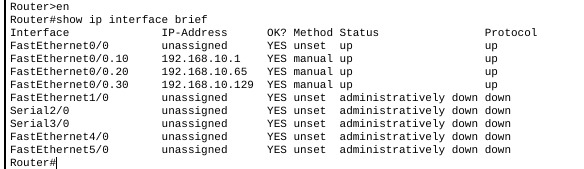
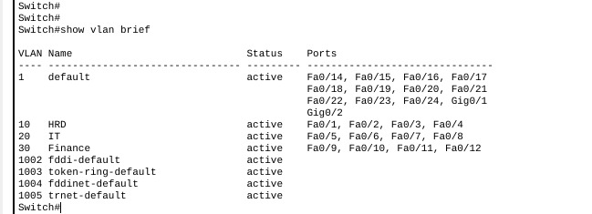
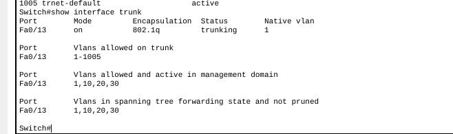
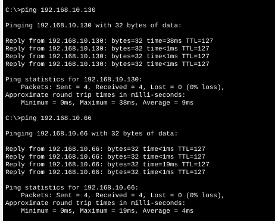

# Small-Business Inter-VLAN Routing & Network Segmentation Infrastructure
## This project was created to illustrate the network topology of a small company or small startup that is just starting its business journey

## VLAN Table
|VLAN ID|Name/Departement|Network Address|Subnet Mask|Default Gateway|Usable Host Range|
| :--- | :--- | :--- | :--- | :--- | :--- |
|10|HRD|192.168.10.0|255.255.255.192|192.168.10.1|192.168.10.2-192.168.10.62|
|20|IT|192.168.10.64|255.255.255.192|192.168.10.65|192.168.10.66-192.168.10.126|
|30|Finance|192.168.10.128|255.255.255.192|192.168.10.129|192.168.10.130-192.168.10.190|


## IP Address Table
|Devices|Interface/VLAN|IP Address|Subnet Mask|Gateway|Notes|
| :--- | :--- | :--- | :--- | :--- | :--- |
| **Router0** | Fa0/0.10 | 192.168.10.1/26 | 255.255.255.192 | - | The Main Router (VLAN 10 for HRD) |
| -------- | Fa0/0.20 | 192.168.10.65/26 | 255.255.255.192 | - | The Main Router (VLAN 20 for IT) |
| -------- |Fa0/0.30|192.168.10.129/26|255.255.255.192|-|The Main Router (VLAN 30 for Finance)|
| **SW-MAIN** | Fa0/1 | - | Unassigned | Unassigned | - | Trunk Link ke Router0 |
| **PC0** | Fa0/2 / 10 | 192.168.10.3 | 255.255.255.192 | 192.168.10.1 | HRD Division |
| **PC1** | Fa0/3 / 10 | 192.168.10.2 | 255.255.255.192 | 192.168.10.1 | HRD Division |
| **PC2** | Fa0/4 / 10 | 192.168.10.4 | 255.255.255.192 | 192.168.10.1 | HRD Division |
| **PC3** | Fa0/5 / 10 | 192.168.10.5 | 255.255.255.192 | 192.168.10.1 | HRD Division |
| **PC4** | Fa0/6 / 20 | 192.168.10.68 | 255.255.255.192 | 192.168.10.65 | IT Division |
| **PC5** | Fa0/7 / 20 | 192.168.10.66 | 255.255.255.192 | 192.168.10.65 | IT Division |
| **PC6** | Fa0/8 / 20 | 192.168.10.67 | 255.255.255.192 | 192.168.10.65 | IT Division |
| **PC7** | Fa0/9 / 20 | 192.168.10.69 | 255.255.255.192 | 192.168.10.65 | IT Division |
| **PC8** | Fa0/10 / 30 | 192.168.10.132 | 255.255.255.192 | 192.168.10.129 | Finance Division |
| **PC9** | Fa0/11 / 30 | 192.168.10.131 | 255.255.255.192 | 192.168.10.129 | Finance Division |
| **PC10** | Fa0/13 / 30 | 192.168.10.133 | 255.255.255.192 | 192.168.10.129 | Finance Division |
| **PC11** | Fa0/12 / 30 | 192.168.10.130 | 255.255.255.192 | 192.168.10.129 | Finance Division |


## The Main Configuration (CLI)

### Activates The Main Physical Interface
```cisco
Router> enable
Router# configure terminal
Router(config)# interface FastEthernet0/0
Router(config-if)# no shutdown
```

### Setup The VLAN And VLAN Name
```cisco
Switch>enable
Switch>confifgure terminal
Switch(config)#vlan 10
Switch(config-vlan)#name HRD
Switch(config-vlan)#exit
Switch(config)#vlan 20
Switch(config-vlan)#name IT
Switch(config-vlan)#exit
Switch(config)#vlan 30
Switch(config-vlan)#name Finance
Switch(config-vlan)#exit
```
## Setup Switchport Mode & Access
```cisco
Switch(config)#interface range fa0/1-4
Switch(config-if-range)#switchport mode access
Switch(config-if-range)#switchport access vlan 10
Switch(config-if-range)#exit
Switch(config)#interface range fa0/5-8
Switch(config-if-range)#switchport mode access
Switch(config-if-range)#switchport access vlan 20
Switch(config-if-range)#exit
Switch(config)#interface range fa0/9-12
Switch(config-if-range)#switchport mode access
Switch(config-if-range)#switchport access vlan 30
Switch(config-if-range)#exit
```
### Trunk Port Configuration On Switch
```cisco
Switch(config)#interface fa0/13
Switch(config-if)#switchport mode trunk
Switch(config-if)#exit
```

### Router On-Stick
```cisco
Router> enable
Router# configure terminal

! Sub Interface Configuration for VLAN 10 (HRD)
Router(config)# interface FastEthernet0/0.10
Router(config-subif)# encapsulation dot1Q 10
Router(config-subif)# ip address 192.168.10.1 255.255.255.192
Router(config-subif)# exit

! Sub-interface Configuration for VLAN 20 (IT)
Router(config)# interface FastEthernet0/0.20
Router(config-subif)# encapsulation dot1Q 20
Router(config-subif)# ip address 192.168.10.65 255.255.255.192
Router(config-subif)# exit

! Konfigurasi Sub-interface untuk VLAN 30 (Finance)
Router(config)# interface FastEthernet0/0.30
Router(config-subif)# encapsulation dot1Q 30
Router(config-subif)# ip address 192.168.10.129 255.255.255.192
Router(config-subif)# end
```
### Configuring IP Exception
```cisco
Router(config)#ip dhcp excluded-address 192.168.10.1
Router(config)#ip dhcp excluded-address 192.168.10.65
Router(config)#ip dhcp excluded-address 192.168.10.129
```

### Configuring Router As DHCP
```cisco
Router(dhcp-config)#ip dhcp pool HRD
Router(dhcp-config)#network 192.168.10.0 255.255.255.192
Router(dhcp-config)#default-router 192.168.10.1
Router(dhcp-config)#dns-server 8.8.8.8
Router(dhcp-config)#exit
Router(config)#ip dhcp pool IT
Router(dhcp-config)#network 192.168.10.64 255.255.255.192
Router(dhcp-config)#default-router 192.168.10.65
Router(dhcp-config)#dns-server 8.8.8.8
Router(dhcp-config)#exit
Router(config)#ip dhcp pool Finance
Router(dhcp-config)#network 192.168.10.128 255.255.255.192
Router(dhcp-config)#default-router 192.168.10.129
Router(dhcp-config)#dns-server 8.8.8.8
Router(dhcp-config)#exit
```
### Router Interface Verification


### Vlan Show Verification 


### Trunk Show Verification


### Ping Inter-VLAN Verification

